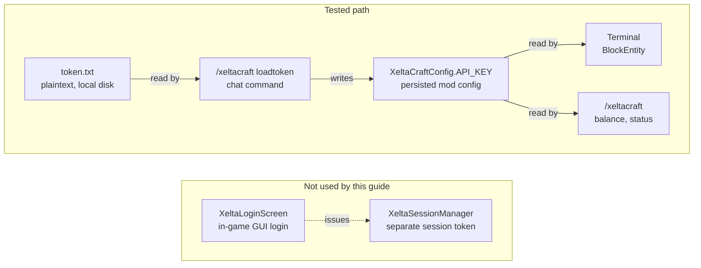
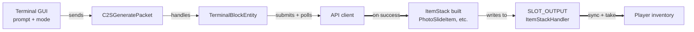
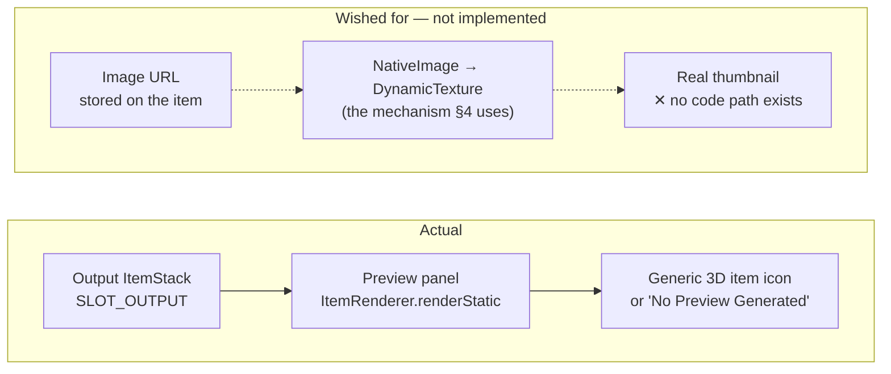
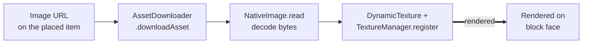
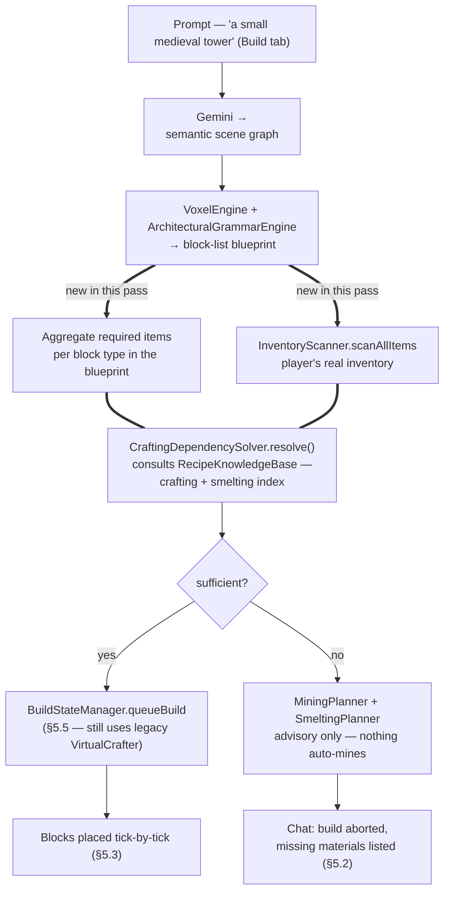
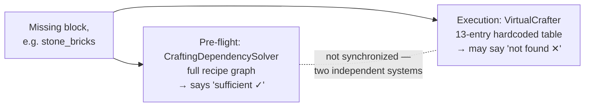

# XeltaCraft Manual Test Guide

Covers everything reviewed/built in this pass: auth, Terminal generation + item
delivery, the Preview panel gap, Media Canvas, and the new resource-planning
pipeline (Recipe Knowledge Base → Crafting Dependency Solver → Resource
Availability Check → Mining/Smelting Planners) wired into World Build mode.

Every mechanism is drawn as a flow before it's tested. Diagrams are Mermaid —
render automatically in VS Code's Markdown preview and on GitHub.

All commands are typed in the in-game chat (press `T`).

**Legend used in every diagram below:** solid box = existing component ·
`===` heavier border = new this pass · dashed = not exercised / not connected.

---

## 0. Launch

```powershell
cd NeoForge\projects\xeltacraft
.\gradlew.bat runClient
```

Create/join a **Survival** world for most tests below — several scenarios
specifically exercise inventory/material checks that Creative mode bypasses.
Keep a Creative-mode test world or `/gamemode creative` handy for §5.1.

---

## 1. Auth

The Terminal reads its token from a mod-config value, not from the in-game
login screen — the two are separate stores. This guide exercises the path the
Terminal actually uses.



*Fig. 1 — Two independent auth stores. This guide uses the tested path because it's the one the Terminal actually reads. The login-screen path issues a session token the Terminal never looks at.*

```
> /xeltacraft loadtoken C:\Users\GCV\AppData\Local\Temp\claude\c--Users-GCV-Desktop-minecraft\e2db2065-a941-43e6-8d4e-e3e423793f58\scratchpad\xelta_token.txt
> /xeltacraft balance
> /xeltacraft status
```

> **Expected:** `balance` prints your real Xelta credit total. Delete the
> scratch token file once done — it's plaintext on disk. If `balance` fails
> with 401/403 after **2026-08-16**, that's an expired token, not a bug.

---

## 2. Generation + item delivery

Confirms the full round trip: a prompt in the Terminal GUI becomes a real,
retrievable item in your inventory.



*Fig. 2 — Generation to item delivery. The heavier arrows are the hops where the generated result actually becomes a real item.*

Give yourself a Terminal, place it, open the GUI, enter a prompt (e.g. *"a red
sports car"*), leave mode on **Photo Lab**, click Generate.

```
> /give @p xeltacraft:xelta_terminal
```

> **Expected:** A `Photo Slide` item appears in the output slot once the job
> completes — take it into your inventory and check its tooltip carries the
> image URL/prompt.

---

## 3. Preview panel — known gap, not a bug



*Fig. 3 — What the Preview panel actually shows vs. what a thumbnail would require. The lower row doesn't exist in code. Gallery tab has the same gap — filename + badge, no thumbnail render.*

> **Expected (current behavior, unchanged):** A generic item icon, or "No
> Preview Generated" text if the slot is empty. Don't file this as a
> regression — it's a documented gap this pass didn't touch.

---

## 4. Media Canvas — the one real image preview



*Fig. 4 — Media Canvas texture pipeline. Every hop here is implemented and working. Video (`.mp4`) is skipped by design — no decoder — this pipeline is images-only.*

```
> /give @p xeltacraft:media_canvas
```

> **Expected:** Place it and feed it a generated image URL — the block face
> renders the downloaded image as a live texture. Skip `.mp4` URLs; video
> isn't supported here.

---

## 5. World Build resource pipeline (new this pass)

The main thing this pass added: a real pre-flight material check before a
Gemini-generated blueprint gets built, instead of discovering a shortfall
mid-placement.



*Fig. 5 — The full pre-flight pipeline. Double-lined arrows/boxes = added this pass; the branch at the bottom is what §5.2–§5.4 exercise.*

Switch to the **Build** tab (mode 4). The style word in your prompt drives
which blocks get requested — use `medieval` for the reproducible tests below.

| Style keyword | wall_primary | roof_trim | roof_primary | pillar_block |
|---|---|---|---|---|
| `medieval` | Stone Bricks | Cobblestone | Spruce Planks | Oak Log |
| `steampunk` | Copper Block | Deepslate Bricks | Dark Oak Planks | Iron Bars |
| `modern` | Quartz Block | White Concrete | Lt. Blue Glass | Smooth Stone |
| `nature` | Oak Leaves | Oak Log | Dirt | Grass Block |

### 5.1 Creative mode — pre-flight is skipped entirely

```
> /gamemode creative
```
> **Expected:** Build proceeds immediately, no material check of any kind.

### 5.2 Survival, empty-handed — abort with a real report

Clear stone bricks / cobblestone / stone / spruce planks / oak logs / oak
stairs from your inventory, then run `"a small medieval tower"`.

```
Build aborted — missing materials for this blueprint:
  • 12x stone_bricks — Mine stone_bricks or cobblestone
  • 4x oak_log — Mine oak_log
  • 4x spruce_planks — No known ore/block source — obtain directly.
Gather these and try again, or switch to Creative mode.
```

> **Expected:** No blocks placed. Counts vary with structure size — the point
> is a concrete, actionable list instead of a silent or mid-build failure.

### 5.3 Survival, fully stocked — build proceeds normally

```
> /give @p minecraft:stone_bricks 64
> /give @p minecraft:cobblestone 64
> /give @p minecraft:spruce_planks 64
> /give @p minecraft:oak_log 64
> /give @p minecraft:oak_stairs 64
```

> **Expected:** No abort message. Blocks place tick-by-tick as before,
> inventory visibly decreases.

### 5.4 Survival — the actual crafting/smelting chain in action

Vanilla: `stone_bricks` crafts from `4× stone`; `stone` itself is **smelted**
from `cobblestone`. Give only the raw material:

```
> /give @p minecraft:cobblestone 64
```

No stone, no stone_bricks, no oak_log, no spruce_planks. Run the tower prompt
again.

> **Expected:** `stone_bricks` reads as covered — resolved through the
> crafting→smelting chain down to the cobblestone you hold — while
> `oak_log`/`spruce_planks` still show missing (unrelated to cobblestone).
> Stock those two alongside the cobblestone and the whole plan should report
> sufficient, confirming the solver chained both recipe types correctly
> instead of doing a flat 1:1 swap.

### 5.5 Known limitation — read before treating anything as a bug



*Fig. 6 — Two unmerged systems. If you see a mid-build "Out of X" abort right after a pre-flight pass, it's this known gap, not a solver defect.*

The pre-flight check (§5) only decides **whether to start** the build. Actual
block-by-block placement (`world/BuildStateManager.java`) still uses the old
`VirtualCrafter` 13-entry hardcoded substitution table, which was **not**
replaced in this pass (out of the agreed scope). Practically:

- The `stone_bricks ← cobblestone` case in §5.4 happens to work at execution
  time too, because `VirtualCrafter` already hardcodes that exact pair.
- But for a missing item resolved by the *new* solver through a chain
  `VirtualCrafter` doesn't know about, the pre-flight can say "sufficient"
  and the build can still halt mid-way with `"Build halted: Out of X"` at
  placement time, because the two systems aren't unified.

If you hit that during testing, it's a known consistency gap between the
pre-flight planner and legacy execution-time substitution — not a defect in
the solver itself. Flag it if you want it fixed (it'd mean routing
`BuildStateManager`'s per-block substitution through the same
`CraftingDependencySolver` instead of `VirtualCrafter`).

---

## 6. Command quick reference

| Command | Purpose |
|---|---|
| `/xeltacraft loadtoken <path>` | Auth without leaking token to chat logs |
| `/xeltacraft balance` | Verify token + show credits |
| `/xeltacraft status` | Nearby Terminal's current state |
| `/xeltacraft reset` | Force a stuck Terminal back to IDLE |
| `/xeltacraft confirm` | Confirm a >1000-block build (safety gate) |
| `/xeltacraft help` | Full command list |

---

## 7. Automated coverage (already passing, no need to re-run manually)

```powershell
.\gradlew.bat compileJava compileClientJava   # main+client compile
.\gradlew.bat test                            # 9/9 unit tests, incl. 7 new
                                               # CraftingDependencySolverTest cases
.\gradlew.bat build                           # full build
```

---

## 8. Known gaps — not in scope this pass, don't re-report

- No image/video thumbnail in the Terminal Preview panel or Gallery tab (§3).
- History tab has no filter/search/delete.
- Uploads/downloads have no progress reporting or resume support.
- No user-facing "retry failed job" action.
- Auth split-brain: `XeltaLoginScreen` session vs `XeltaCraftConfig.API_KEY`
  are still two separate stores (§1 uses the config-based path deliberately).
- Mining/Smelting planners are advisory-only by design — nothing mines or
  smelts automatically.
