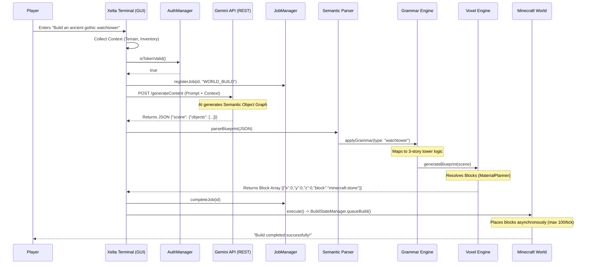
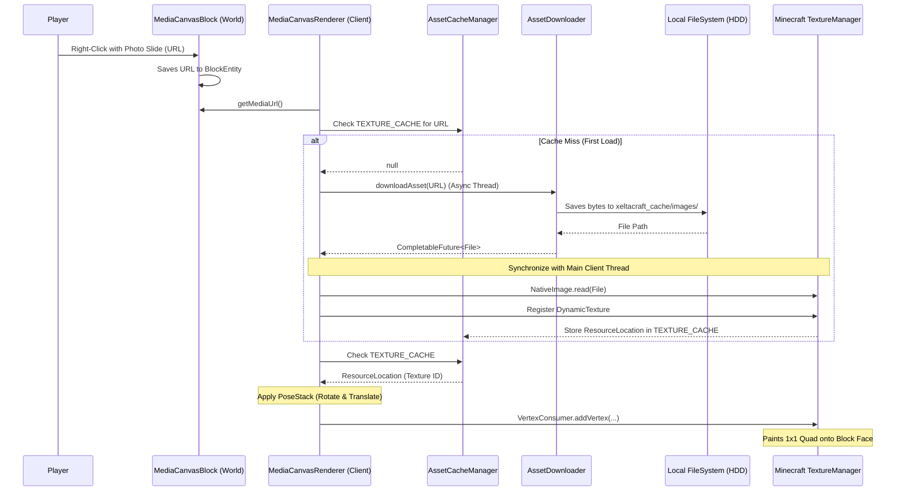

# XeltaCraft MVP Data Flow

Here are the visual data flow diagrams detailing the core systems of the XeltaCraft MVP.

### 1. Architectural World Generation Data Flow

This diagram illustrates how a natural language prompt from the user is transformed into physical blocks in the Minecraft world.

### 2. OpenGL In-World Media Canvas Data Flow

This diagram illustrates how an image URL generated by the AI is securely downloaded, cached, and rendered physically onto a block.

